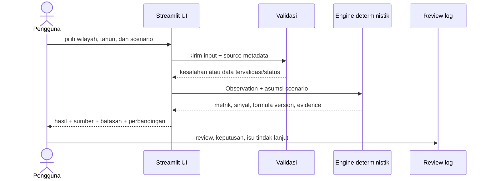

# Alur Engine, UI, dan Review Manusia

## Alur MVP tanpa AI agent

## Langkah kerja aplikasi

1. Muat fixture/masukan pengguna; pertahankan nilai sumber dan metadata tanpa transformasi diam-diam.
2. Validasi field wajib, tahun, level wilayah, kode rekening, status nilai, satuan, dan presisi.
3. Jalankan perhitungan pure function dengan version ID yang jelas.
4. Evaluasi rule deterministik hanya bila prasyarat datanya terpenuhi.
5. Susun output dengan evidence berupa input, formula, source ID, snapshot, dan limitation.
6. Tampilkan baseline dan skenario alternatif berdampingan.
7. Reviewer manusia memberi status, keputusan, dan tindak lanjut di `review-log.md`/`issue-log.md`.

## UI minimum

- Filter jenis TKD (nilai awal DBH SDA Perikanan), tahun (2024), level dan wilayah.
- Panel provenance: lembaga, judul, link, tanggal snapshot, tanggal akses, jenis dokumen, satuan, presisi, dan status verifikasi.
- Form skenario dengan validasi dan label wajib “asumsi/simulasi” untuk nilai alternatif.
- Hasil: pagu, realisasi, rasio, gap/sisa, status data, sinyal, evidence, serta rule/formula version.
- Scenario comparison: baseline, skenario, delta nominal, dan delta persen.
- Review panel: `needs_review`, `accepted`, `rejected`, atau `blocked`, dengan komentar.

## Review ML/BA

Reviewer memeriksa minimal:

1. Akurasi transkripsi dan kecocokan satuan/precision dengan sumber.
2. Formula rasio, delta, pembulatan, dan edge cases.
3. Kelayakan wording sinyal: tidak menyatakan keterlambatan atau risiko resmi dari angka tahunan.
4. Konsistensi tingkat agregasi wilayah dan perlakuan atas Provinsi Jawa Barat yang masih perlu verifikasi.
5. Kemudahan menelusuri evidence, rule version, serta asumsi pada setiap skenario.

Review belum dilakukan oleh manusia hanya karena dokumen ini dibuat oleh AI. Hasil review harus diisi reviewer manusia di log; jangan mengarang persetujuan.

## AI di tahap setelah MVP

LangGraph/LLM baru dipertimbangkan setelah data pipeline, validasi, engine, dan baseline stabil. Perannya dibatasi pada pencarian sumber yang disetujui, peringkasan bukti, dan penjelasan alert. Model tidak boleh menetapkan angka, formula, severity, atau keputusan finansial. Output AI harus menyertakan kutipan/referensi ke evidence dan ditinjau manusia.
