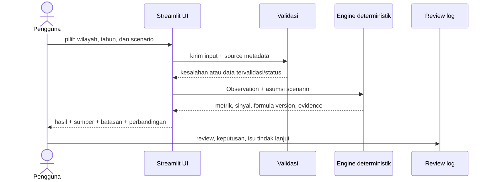

# Alur Engine, UI, dan Review Manusia

## Alur MVP tanpa AI agent

## Langkah kerja target aplikasi

1. Muat fixture/masukan pengguna; pertahankan nilai sumber dan metadata tanpa transformasi diam-diam.
2. Validasi field wajib, tahun, hirarki/kode wilayah, kelengkapan variabel, status nilai, satuan, presisi, dan provenance.
3. Pastikan formula dan bobot DBH Perikanan telah diverifikasi serta berlaku untuk periode yang dipilih; bila belum, hentikan simulasi alokasi dengan status yang jelas.
4. Jalankan formula deterministik berversi; hasilkan estimasi per daerah dan rekonsiliasi total dengan pagu acuan.
5. Susun output dengan evidence berupa input, asumsi, langkah formula, source ID, snapshot, versi aturan, residual, dan batasan.
6. Tampilkan baseline dan skenario alternatif berdampingan serta selisih per daerah dan agregat.
7. Reviewer manusia memeriksa substansi/angka dan mencatat status, keputusan, serta tindak lanjut di `review-log.md`/`issue-log.md`.

## UI minimum

- Filter jenis TKD (nilai awal DBH SDA Perikanan), tahun (default 2026), level dan wilayah nasional/agregat `Se-Prov` jika datanya tersedia.
- Panel provenance: lembaga, judul, link, tanggal snapshot, tanggal akses, jenis dokumen, satuan, presisi, dan status verifikasi.
- Form input data/parameter yang tersedia dari sumber resmi; label wajib “asumsi/simulasi” untuk override.
- Hasil target: estimasi per daerah, total dan rekonsiliasi pagu, status data, sinyal, evidence, serta formula/regulation version.
- Scenario comparison target: baseline dan skenario, delta per daerah/agregat, perubahan parameter, serta selisih terhadap pagu/periode pembanding.
- Jika formula belum diverifikasi, panel menjelaskan alasan simulasi alokasi belum dapat dijalankan. Pagu/realisasi SIKD boleh ditampilkan sebagai demonstrator monitoring dengan label berbeda.
- Review panel: `needs_review`, `accepted`, `rejected`, atau `blocked`, dengan komentar.

## Review ML/BA

Reviewer memeriksa minimal:

1. Akurasi transkripsi dan kecocokan satuan/precision dengan sumber.
2. Formula rasio, delta, pembulatan, dan edge cases.
3. Kelayakan wording sinyal: tidak menyatakan keterlambatan atau risiko resmi dari angka tahunan.
4. Konsistensi tingkat agregasi wilayah; label `Se-Prov` sebagai agregat, bukan alokasi Pemprov, serta penandaan data yang belum terverifikasi.
5. Kemudahan menelusuri evidence, rule version, serta asumsi pada setiap skenario.
6. Validitas formula/bobot, sumber acuan, dan rekonsiliasi total hasil terhadap pagu.

Review belum dilakukan oleh manusia hanya karena dokumen ini dibuat oleh AI. Hasil review harus diisi reviewer manusia di log; jangan mengarang persetujuan.

## AI di tahap setelah MVP

LangGraph/LLM baru dipertimbangkan setelah data pipeline, validasi, engine, dan baseline stabil. Perannya dibatasi pada pencarian sumber yang disetujui, peringkasan bukti, dan penjelasan alert. Model tidak boleh menetapkan angka, formula, severity, atau keputusan finansial. Output AI harus menyertakan kutipan/referensi ke evidence dan ditinjau manusia.
