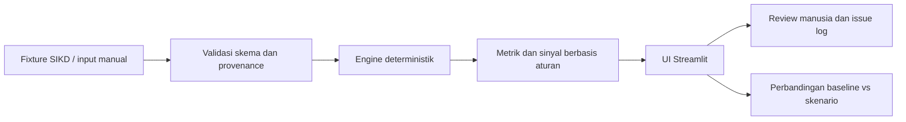

# Arsitektur MVP: Engine, UI, dan Perbandingan Skenario

## Sasaran vertical slice

MVP membuktikan satu alur dari data ke keputusan yang bisa diperiksa:

1. Pengguna memilih wilayah dan dataset DBH SDA Perikanan TA 2024 atau memasukkan skenario alternatif.
2. Aplikasi memvalidasi input dan menampilkan sumber, satuan, presisi, dan status data.
3. Engine Python deterministik menghitung rasio pagu/realisasi, selisih pagu, dan perbandingan skenario.
4. UI menampilkan hasil, alasan sinyal, keterbatasan, dan jejak sumber.
5. Reviewer dapat memeriksa keluaran dan menulis keputusan/issue pada log review.

Prototype tidak menghitung formula legal alokasi DBH Perikanan, tidak memprediksi penerimaan, dan tidak memberi rekomendasi fiskal otomatis. Ia menganalisis angka pagu/realisasi yang sudah dipublikasikan.

## Pilihan komponen

| Komponen | Pilihan MVP | Alasan |
|---|---|---|
| Bahasa | Python | Sesuai arahan proyek dan cocok untuk pipeline serta perhitungan data. |
| UI | Streamlit | Cara cepat membuat input, tabel, dan scenario comparison untuk internal demo. |
| API | Tidak wajib pada vertical slice pertama; FastAPI ditambahkan saat UI dan klien lain memerlukan kontrak backend stabil. | Hindari dua lapis aplikasi sebelum ada kebutuhan. Target arsitektur berikutnya tetap FastAPI + Streamlit. |
| Engine | Fungsi Python murni, tanpa LLM | Hasil angka harus dapat diulang, diuji, dan diaudit. |
| Penyimpanan | Fixture CSV/JSON berversi di repo untuk prototype awal | Cukup untuk dataset kecil; setiap baris harus punya provenance. PostgreSQL masuk setelah alur dan skema disetujui. |
| Agent/LLM | Di luar vertical slice | Tidak diperlukan untuk menghitung metrik; kelak hanya membantu merangkum bukti dengan review manusia. |

## Pemisahan tanggung jawab

```text
src/
  README.md                 # status prototype dan rencana modul
  app.py                    # rencana entry point Streamlit
  engine/                    # perhitungan murni dan validasi
  data/                      # fixture + loader sumber
  ui/                        # komponen tampilan bila app.py membesar
```

UI prototype v0 sekarang berada di `src/app.py`, perhitungan murni di `src/engine/calculations.py`, dan fixture/provenance di `src/data/observations.json`. UI belum bisa dijalankan di lingkungan kerja saat ini karena Streamlit belum terpasang; `requirements.txt` mendeklarasikan dependensinya. Struktur lanjutan tetap ditambahkan bertahap setelah slice ini direview.

### Alur data



## Bentuk input dan hasil

Input minimum: jenis TKD, tahun anggaran, kode/nama wilayah, pagu, realisasi, satuan, sumber, snapshot, tingkat presisi, status nilai, dan label skenario. Input tidak valid harus ditolak dengan pesan jelas; data yang tidak tersedia harus tetap dapat ditampilkan sebagai status, tidak dikonversi ke angka nol.

Hasil minimum:

- rasio realisasi terhadap pagu;
- sisa terhadap pagu;
- perubahan dari skenario dasar dalam rupiah dan persentase jika pembagi bukan nol;
- status kualitas data;
- sinyal berbasis aturan dengan penjelasan dan bukti input;
- source/version stamp pada setiap output.

## Keamanan dan kontrol

- Tidak ada rahasia/credential pada fixture atau browser.
- Validasi tipe wilayah dan kode rekening; batasi input angka negatif kecuali sumber mendefinisikan koreksi yang sah.
- Jangan mengizinkan teks input mengubah formula engine.
- Simpan nilai rupiah sebagai integer atau Decimal, tidak menggunakan float untuk nominal finansial.
- Tampilkan status `rounded_display` bila sumber hanya memberi angka pembulatan.
- Sinyal yang memengaruhi keputusan harus memuat evidence, formula, sumber, dan versi aturan, serta bertanda `human_review_required`.

## Di luar MVP

Login/tenant, pembayaran, job scheduler, scraper otomatis, PostgreSQL, pgvector/RAG, LangGraph, notifikasi eksternal, forecasting ML, dan rekomendasi alokasi. Penambahan dilakukan setelah kualitas sumber dan vertical slice diterima reviewer.

## Definition of Done teknis untuk implementasi nanti

- Aplikasi dapat dijalankan dari instruksi README pada lingkungan Python yang ditetapkan.
- Input, hasil, dan minimal dua skenario terlihat pada UI.
- Angka nasional SIKD pada presisi tampilan dapat direproduksi sebagai 99,22%.
- Data daerah tampil dengan provenance dan status presisi.
- Data tingkat Provinsi Jawa Barat yang belum terverifikasi tidak menyamar sebagai nol.
- ML/BA mengisi review log; blocker demo ditutup atau secara eksplisit diterima sebelum showcase.
