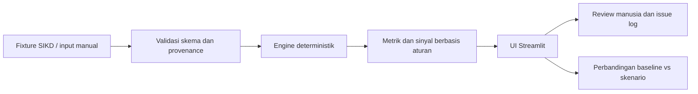

# Arsitektur MVP: Engine, UI, dan Perbandingan Skenario

## Sasaran target vertical slice

MVP membuktikan satu alur dari data ke keputusan yang bisa diperiksa:

1. Pengguna memilih observasi DBH SDA Perikanan TA2026 (baseline nasional berjalan) atau periode historis yang tersedia, lalu memasukkan/mengubah asumsi skenario.
2. Aplikasi memvalidasi kelengkapan, hierarki wilayah, satuan, presisi, provenance, dan versi aturan.
3. Engine deterministik menerapkan formula alokasi DBH Perikanan yang sudah diverifikasi, menghitung estimasi daerah, dan memeriksa rekonsiliasi terhadap pagu acuan.
4. UI menyajikan estimasi, perbandingan skenario, selisih antarperiode/pagu, sumber, asumsi, formula, versi, batasan, dan audit trail.
5. Reviewer memeriksa angka dan substansi, lalu mencatat keputusan/issue.

**Status implementasi:** `src/app.py` menyediakan dashboard Streamlit yang default-nya memilih tahun terbaru dalam fixture, saat ini TA2026. Fixture memuat satu observasi nasional TA2026 dan tiga observasi historis TA2025. Engine alokasi, pengambilan data otomatis, penyimpanan permanen, serta scenario comparison hasil hitung resmi belum tersedia. Data 2026 per provinsi dan angka final tahun belum diverifikasi. Untuk menghitung formula, perlu data nasional tingkat kabupaten/kota, basis penerimaan/PNBP dan luas laut terverifikasi, parameter kinerja yang berlaku, serta acuan hitung. Jangan menyimpulkan alokasi pemerintah provinsi dari agregat `Se-Prov`.

Prototype tidak memprediksi penerimaan atau memberi keputusan fiskal otomatis. Hasil simulator adalah bahan analisis, bukan penetapan alokasi final.

## Pilihan komponen

| Komponen | Pilihan MVP | Alasan |
|---|---|---|
| Bahasa | Python | Sesuai arahan proyek dan cocok untuk pipeline serta perhitungan data. |
| UI | Streamlit | Cara cepat membuat input, tabel, dan scenario comparison untuk internal demo. |
| API | Tidak wajib pada vertical slice pertama; FastAPI ditambahkan saat UI dan klien lain memerlukan kontrak backend stabil. | Hindari dua lapis aplikasi sebelum ada kebutuhan. Target arsitektur berikutnya tetap FastAPI + Streamlit. |
| Engine | Fungsi Python murni, tanpa LLM; formula dialihkan melalui konfigurasi berversi setelah sumber hukum diverifikasi | Hasil harus dapat diulang, diperiksa, dan tidak mencampur aturan antarjenis DBH. |
| Penyimpanan | Fixture CSV/JSON berversi di repo untuk prototype awal | Cukup untuk dataset kecil; setiap baris harus punya provenance. PostgreSQL masuk setelah alur dan skema disetujui. |
| Agent/LLM | Di luar vertical slice | Tidak diperlukan untuk menghitung metrik; kelak hanya membantu merangkum bukti dengan review manusia. |

## Pemisahan tanggung jawab

```text
src/
  README.md                 # status prototype dan rencana modul
  app.py                    # rencana entry point Streamlit
  engine/                    # perhitungan murni dan validasi
  data/                      # fixture + loader sumber
  ui/                        # komponen tampilan bila app.py membesar
```

Penulisan kode belum dilakukan pada tahap dokumen ini. Struktur di atas adalah kontrak implementasi awal; setiap modul harus dijelaskan sebelum ditambahkan.

### Alur data



## Bentuk input dan hasil

Input target simulator: jenis TKD, tahun, penerimaan DBH Perikanan, kode/nama dan tingkat wilayah, wilayah penerima, variabel serta bobot formula yang bersumber dari regulasi, data historis yang memang dibutuhkan formula, pagu indikatif, satuan, presisi, sumber/snapshot, versi regulasi/formula, status nilai, dan label skenario. Observasi SIKD pagu/realisasi tetap menjadi data pembanding, bukan pengganti otomatis bagi variabel formula. Input tidak valid harus ditolak dengan pesan jelas; data yang tidak tersedia tetap berstatus unavailable/unverified, bukan angka nol.

Hasil target simulator:

- estimasi alokasi per wilayah penerima;
- total hasil dan rekonsiliasi terhadap pagu acuan, termasuk residual bila tidak tepat sama;
- perbandingan baseline dan skenario, termasuk perubahan parameter dan dampaknya;
- selisih antarperiode dan terhadap pagu jika periode/basis dapat dibandingkan;
- jejak input, formula, versi, sumber, dan langkah perhitungan.

Hasil demonstrator monitoring sementara (bukan simulasi alokasi):

- rasio realisasi terhadap pagu;
- sisa terhadap pagu;
- perubahan dari skenario dasar dalam rupiah dan persentase jika pembagi bukan nol;
- status kualitas data;
- sinyal berbasis aturan dengan penjelasan dan bukti input;
- source/version stamp pada setiap output.

## Keamanan dan kontrol

- Tidak ada rahasia/credential pada fixture atau browser.
- Validasi tipe wilayah dan kode rekening; batasi input angka negatif kecuali sumber mendefinisikan koreksi yang sah.
- Jangan mengizinkan teks input mengubah formula engine.
- Simpan nilai rupiah sebagai integer atau Decimal, tidak menggunakan float untuk nominal finansial.
- Tampilkan status `rounded_display` bila sumber hanya memberi angka pembulatan.
- Sinyal yang memengaruhi keputusan harus memuat evidence, formula, sumber, dan versi aturan, serta bertanda `human_review_required`.

## Di luar MVP

Login/tenant, pembayaran, job scheduler, scraper otomatis, PostgreSQL, pgvector/RAG, LangGraph, notifikasi eksternal, forecasting ML, dan rekomendasi alokasi. Penambahan dilakukan setelah kualitas sumber dan vertical slice diterima reviewer.

## Definition of Done teknis untuk implementasi nanti

- Aplikasi dapat dijalankan dari instruksi README pada lingkungan Python yang ditetapkan.
- Input data/parameter, hasil alokasi, dan minimal dua skenario terlihat pada UI.
- Formula serta bobot DBH Perikanan mempunyai sumber/version ID yang bisa dibuka; tidak ada bobot Minerba.
- Total alokasi menunjukkan rekonsiliasi ke pagu dan selisihnya dapat dijelaskan.
- Satu skenario cocok dengan contoh acuan independen atau perbedaannya didokumentasikan.
- Data daerah tampil dengan provenance dan status presisi.
- Data provinsi/agregat `Se-Prov` yang belum terverifikasi tidak boleh menyamar sebagai nol atau entitlement Pemprov.
- ML/BA mengisi review log; blocker demo ditutup atau secara eksplisit diterima sebelum showcase.
